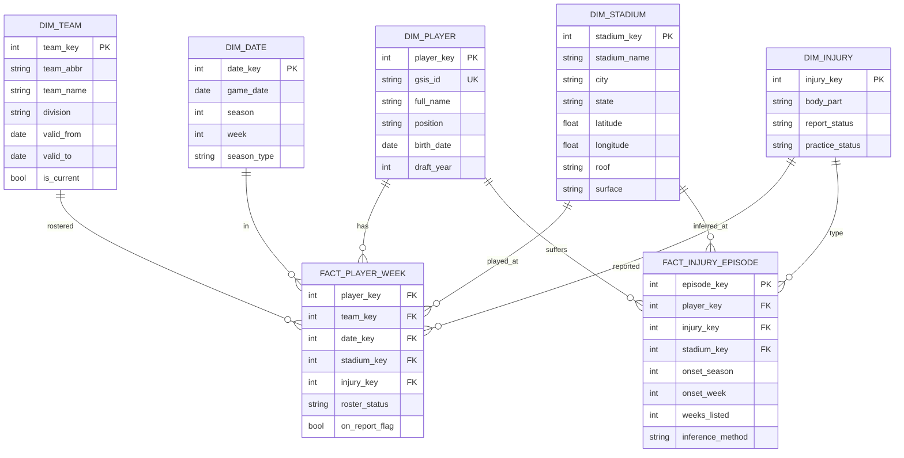

# nfl-injury-analyzer

NFL player availability and injury warehouse, 2010 to present, built from [nflverse](https://github.com/nflverse/nflverse-data) data.

**Status:** extract and raw-layer load are built and unit-tested. Staging, dimensions and facts are next. The raw load has not yet been run against a live SQL Server.

## Goal

Model every NFL player since 2010 in a dimensional warehouse and measure teams played for, years played, weekly injury status, and (inferred) where injuries occurred.

## Design decisions

- **Grain:** `fact_player_week` is one row per player, season, week. Players are a dimension, not the fact.
- **Injury geography is inferred, not sourced.** nflverse injury reports (available since 2009) give weekly status and body part, with no field for where or when the injury happened. `fact_injury_episode` infers the onset venue from the last game before a player first appears on the report, and records `inference_method` so a guess is never mistaken for a fact.
- **Teams are SCD2** (`valid_from`, `valid_to`) to handle franchise relocations.
- **Raw files are retained** under `raw_files/<dataset>/load_date=<date>/season=<year>/` before loading, each with a manifest (url, sha256, row count), so any run can be replayed.
- **Source data findings drive the staging rules.** See [docs/data_profile.md](docs/data_profile.md): team codes differ across datasets and eras, 2010 to 2015 weekly rosters have duplicate keys, and stadium names change while IDs don't.
- **Stadium geography needs a seed.** The games file has stadium ID, roof and surface but no city, state, latitude or longitude, so `dim_stadium` needs a verified 52-row seed.

## Schema



## Pipeline

1. **Extract** (`src/ingestion/extract.py`): downloads weekly rosters, players, games and injuries from nflverse into `raw_files/` with retries, atomic writes, validation and a manifest per file.
2. **Land** (`src/ingestion/load_raw.py`): loads the files as text into `raw.*` tables. Every load is logged in `raw.load_batch` with a row-count reconciliation, and a re-run replaces the same season or table.
3. **Transform:** T-SQL builds `dim_*` and `fact_*`, including the SCD2 team dimension and injury-episode inference.
4. **Test:** Python data quality checks (duplicate player-weeks, orphan `gsis_id`s, impossible team/date combinations, row-count reconciliation against source).
5. **Serve:** Power BI over the star schema.

## Run

Prerequisites: Python 3.10+, SQL Server with the ODBC Driver 18, and an empty database named as `database.name` in `config/dev.yaml` (default `nfl_injury_dev`).

```
pip install -r requirements.txt
python -m src.ingestion.extract                    # download all configured seasons
python -m src.ingestion.load_raw --apply-ddl       # create schemas and raw tables, then load
python -m pytest                                   # unit tests, no database needed
```

Both commands accept `--datasets` and `--seasons` to run a subset.

### Daily refresh

`python -m src.ingestion.run_daily` re-downloads the current season plus the players and games files, checks them, and loads them only if the checks pass. Checks (`src/ingestion/checks.py`): every file column must exist in the `sql/raw` table (catches nflverse format changes), and a re-downloaded file must keep at least `quality.min_rows_vs_previous_ratio` of its previous row count. It exits 1 on any failure and logs to `logs/`. Use `--skip-load` to extract and check without a database.

To schedule it daily (default 05:00 local, after nflverse's 07:00 UTC refresh):

```
.\scripts\register_daily_task.ps1                  # register the Windows scheduled task
Unregister-ScheduledTask -TaskName NflDailyIngestion -Confirm:$false   # remove it
```

## Layout

```
config/             environment settings (dev.yaml), no secrets
src/ingestion/      Python extraction from nflverse
src/utilities/      config loader, shared helpers
scripts/            Windows Task Scheduler setup for the daily refresh
sql/raw|staging|dim|fact/   DDL and transforms, one folder per layer
tests/unit|integration|data_quality/
docs/               schema, data dictionary, decision log
raw_files/          downloaded source files (git-ignored)
```

## Configuration

Settings live in `config/<env>.yaml`, selected by the `NFL_ENV` variable (default `dev`). Secrets never go in YAML: set `DB_USER` and `DB_PASSWORD` as environment variables (see `.env.example`), and only when `database.trusted_connection` is `false`. The loader rejects any config file containing secret-like keys.

```python
from src.utilities.config import load_config

cfg = load_config()                       # NFL_ENV or "dev"
seasons = cfg.season_range(current_season=2025)
conn_str = cfg.connection_string()
```

Run the tests with `python -m pytest`.

## Authors

- Ryan Osborne: concept, data model and design decisions
- Claude (Anthropic): implementation

## Data source

[nflverse](https://github.com/nflverse/nflverse-data), accessed through `nflreadpy` or the release files directly.
