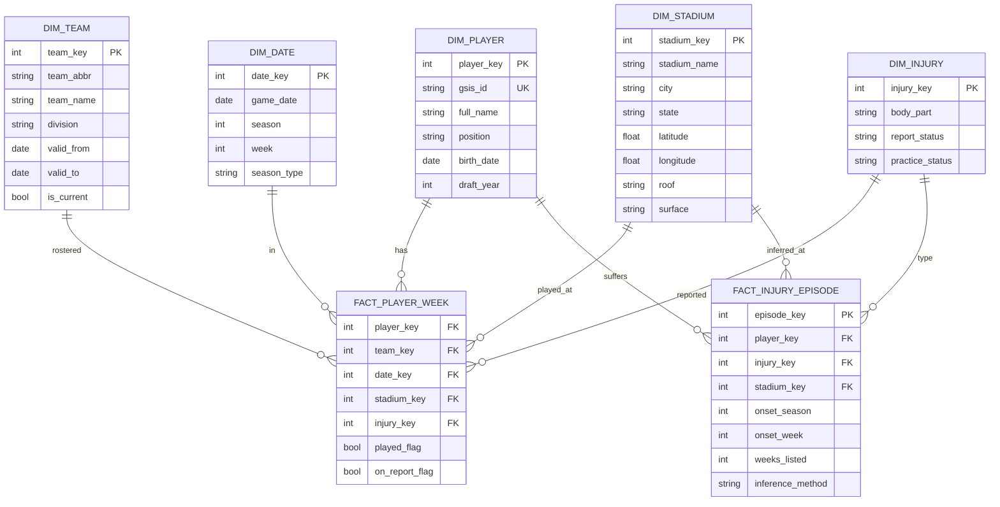

# nfl-injury-analyzer

NFL player availability and injury warehouse, 2010 to present, built from [nflverse](https://github.com/nflverse/nflverse-data) data.

**Status:** scaffold. Schema designed, pipeline not yet built.

## Goal

Model every NFL player since 2010 in a dimensional warehouse and measure teams played for, years played, weekly injury status, and (inferred) where injuries occurred.

## Design decisions

- **Grain:** `fact_player_week` is one row per player, season, week. Players are a dimension, not the fact.
- **Injury geography is inferred, not sourced.** nflverse injury reports (available since 2009) give weekly status and body part, with no field for where or when the injury happened. `fact_injury_episode` infers the onset venue from the last game before a player first appears on the report, and records `inference_method` so a guess is never mistaken for a fact.
- **Teams are SCD2** (`valid_from`, `valid_to`) to handle franchise relocations.
- **Raw files are retained** under `raw_files/` (partitioned by season and load date) before loading, so any run can be replayed.

## Schema



## Pipeline

1. **Extract:** Python pulls nflverse files (rosters, players, schedules, injuries) into `raw_files/`.
2. **Land:** load raw files as-is into `raw.*` tables with `load_date` and `source_file`.
3. **Transform:** T-SQL builds `dim_*` and `fact_*`, including the SCD2 team dimension and injury-episode inference.
4. **Test:** Python data quality checks (duplicate player-weeks, orphan `gsis_id`s, impossible team/date combinations, row-count reconciliation against source).
5. **Serve:** Power BI over the star schema.

## Layout

```
extract/      Python extraction from nflverse
sql/          DDL and transform scripts
tests/        data quality checks
raw_files/    downloaded source files (git-ignored)
```

## Authors

- Ryan Osborne: concept, data model and design decisions
- Claude (Anthropic): implementation

## Data source

[nflverse](https://github.com/nflverse/nflverse-data), accessed through `nflreadpy` or the release files directly.
